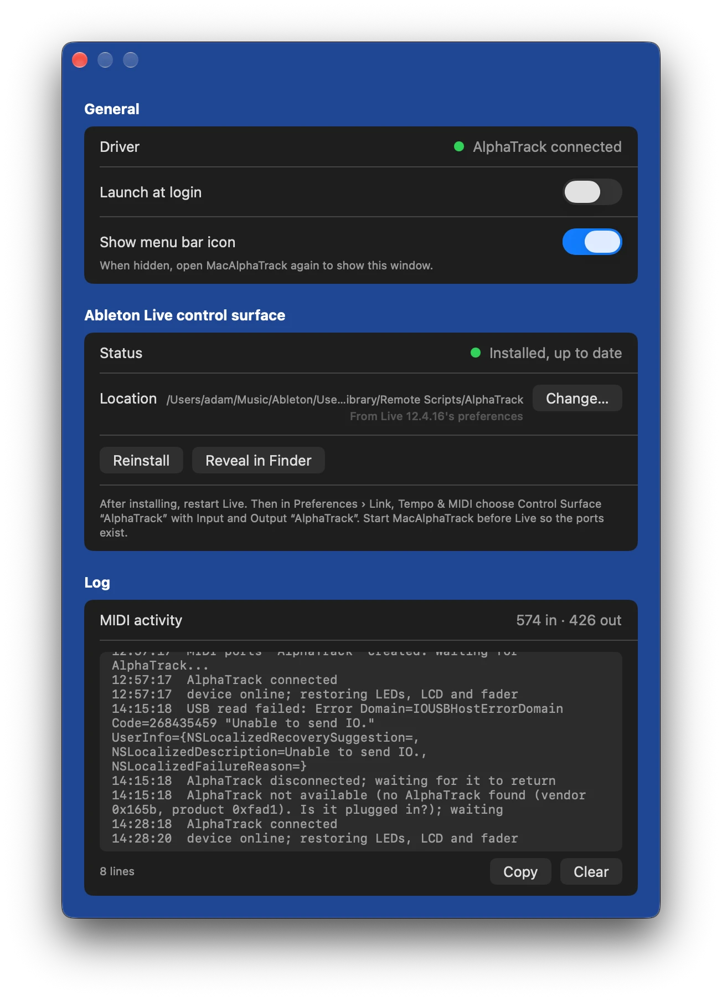

# MacAlphaTrack

Use a Frontier Design Group **AlphaTrack** control surface on a modern Mac. A menu bar app
replaces Frontier's discontinued driver, and adds a control surface for Ableton Live.

## Install

Requires macOS 13 or later.

1. Download the [latest release](https://github.com/sandnuggah/MacAlphaTrack/releases/latest),
   unzip it, and move `MacAlphaTrack.app` to Applications.
2. Open it. The app is not signed with an Apple developer certificate, so macOS blocks the
   first launch. Go to System Settings › Privacy & Security, scroll to the message about
   MacAlphaTrack, and click **Open Anyway**. This is needed once.
3. Plug in the AlphaTrack.

To build it yourself instead, with Xcode installed, run `Scripts/make-app.sh`. A copy you
built opens without the extra step.

## Set up your DAW

Open MacAlphaTrack before your DAW.

**Ableton Live:** in MacAlphaTrack's settings click **Install**, then restart Live. In Live's
Preferences › Link, Tempo & MIDI choose Control Surface **AlphaTrack** with Input and Output
**AlphaTrack**. The controls are listed in [LiveRemoteScript/README.md](LiveRemoteScript/README.md).

**Other DAWs:** set up the AlphaTrack in Native mode with the **AlphaTrack** MIDI input and
output.

## More

[Developer notes](docs/DEVELOPMENT.md) · [Protocol](docs/PROTOCOL.md) · [Unlicense](LICENSE)
